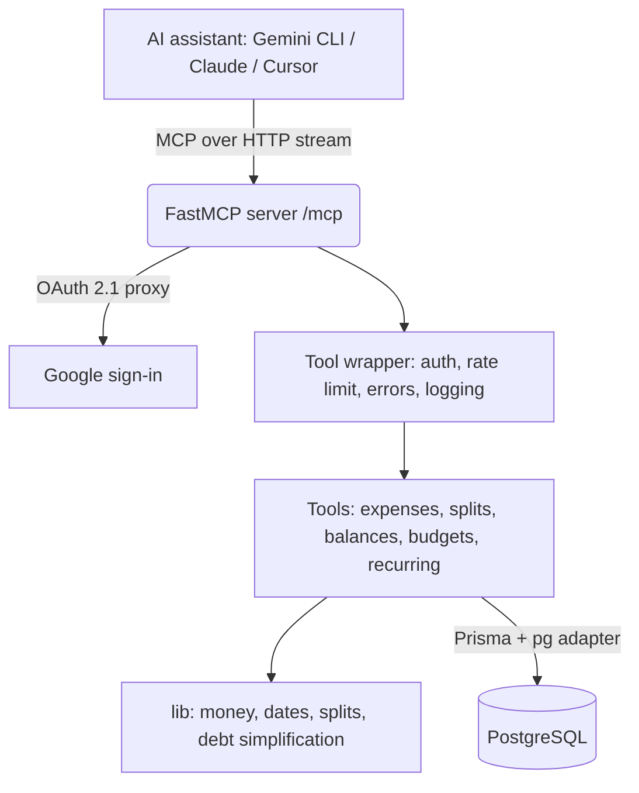

# Expense Tracker MCP Server

A Splitwise-style expense tracker and bill splitter that you use by talking to an AI assistant. It is a [Model Context Protocol](https://modelcontextprotocol.io) (MCP) server: Gemini CLI, Claude, Cursor or any MCP client can call its tools to record expenses, split bills, track budgets and settle up.

> "I paid ₹2,400 for dinner with rahul@gmail.com and priya@gmail.com, split equally"
> "How much did I spend on food this month, and am I over budget?"
> "Who owes me money? Settle up with Rahul for ₹500"

Built with [FastMCP](https://github.com/punkpeye/fastmcp), [Prisma](https://www.prisma.io/) and PostgreSQL. Users sign in with Google.

## Features

- **Expenses** with categories, currencies and flexible dates (`2026-10-30`, `today`, ISO date-times), interpreted in each user's own time zone.
- **Five ways to split**: equal, exact amounts, percentages, shares (2:1), and itemized receipts where tax and tip are shared in proportion to what each person ordered.
- **Exact money**: amounts are stored as integer paise/cents, and every split adds up to the total to the last paisa.
- **Balances that net out**: per friend, per currency, after payments. Group balances suggest the fewest payments that settle everyone up.
- **Payments with confirmation**: partial payments are supported. A payment recorded by the person who owed money stays pending until the person who received it confirms it.
- **Budgets**: weekly or monthly limits per category or overall, with automatic alerts at 80% and 100%.
- **Recurring expenses**: rent, subscriptions and SIPs are created automatically when due, and past occurrences are back-filled.
- **Import / export**: bulk import (bank statements, CSV, UPI/bank SMS parsed by the AI) with duplicate detection, and CSV export.
- **Friends, groups and invites**: people who have not signed up yet get a placeholder account, and their shares are waiting for them when they sign in with Google. Optional invite and reminder emails are sent through Resend.
- **MCP extras**: tool annotations (read-only and destructive hints), ready-made prompts (`monthly-report`, `split-receipt`, `settle-group`) and live resources (balances, budgets, this month's spending).
- **Production basics**: config validated at startup, structured JSON logs with token redaction, per-user rate limiting, a `/health` endpoint, versioned migrations, CI on real Postgres, and a multi-stage non-root Docker image.

## Architecture



| Folder | What lives there |
| --- | --- |
| `main.ts` | Entry point: validates config, starts the server, graceful shutdown |
| `server.ts` | Registers tools, prompts and resources, plus the shared tool wrapper |
| `tools/` | Business logic for each area (expenses, groups, balances, budgets, recurring, profile) |
| `types/` | Zod input schemas. Field descriptions guide the AI on formats |
| `lib/` | Pure helpers: money allocation, time zones, split calculator, debt simplification, logger, rate limiter |
| `prisma/` | Schema and versioned migrations |
| `tests/unit`, `tests/integration` | Fast logic tests, and end-to-end tests against a real Postgres |

## Setup

Requirements: Node.js 20+ (22 recommended), pnpm, a PostgreSQL database (Neon works well), and a Google OAuth client.

```bash
git clone https://github.com/AbbojuRaviTeja/expense-tracker-mcp-server.git
cd expense-tracker-mcp-server
pnpm install
cp .env.example .env      # then fill it in
pnpm db:generate
pnpm db:deploy            # apply migrations
pnpm dev
```

In Google Cloud Console, add **`{BASE_URL}/oauth/callback`** (for example `http://localhost:8000/oauth/callback`) to the OAuth client's *Authorized redirect URIs*.

### Environment variables

| Variable | Required | Default | Purpose |
| --- | --- | --- | --- |
| `DATABASE_URL` | yes | | PostgreSQL connection string |
| `GOOGLE_CLIENT_ID`, `GOOGLE_CLIENT_SECRET` | yes | | Google OAuth client |
| `BASE_URL` | yes | | Public URL of the server |
| `PORT` | no | `8000` | Listen port |
| `DEFAULT_TIMEZONE` | no | `UTC` | Time zone for new users (e.g. `Asia/Kolkata`) |
| `DEFAULT_CURRENCY` | no | `INR` | Currency for new users |
| `RATE_LIMIT_PER_MINUTE` | no | `60` | Tool calls per user per minute |
| `LOG_LEVEL` | no | `info` | `debug`, `info`, `warn`, `error` |
| `RESEND_API_KEY`, `EMAIL_FROM` | no | | Enable invite and reminder emails |

The server refuses to start if a required variable is missing or invalid, and lists every problem.

### Upgrading an existing v1 database

Version 1 created its tables with `prisma db push`, so Prisma has no record of them. **Back up the database first**, then mark the first two migrations as already applied and run the upgrade. The upgrade converts rupee amounts to paise, turns splits marked as paid into confirmed payments, merges duplicate split rows, and adds each payer's own share:

```bash
pnpm exec prisma migrate resolve --applied 20260405055419_initial_migration
pnpm exec prisma migrate resolve --applied 20260405120000_multi_user_splitwise
pnpm db:deploy
```

## Connecting an AI client

Replace `https://your-deployment.example.com/mcp` below with your server's URL (`http://localhost:8000/mcp` when running locally).

**Gemini CLI** (`~/.gemini/settings.json`):

```json
{
  "mcpServers": {
    "expense-tracker": {
      "httpUrl": "https://your-deployment.example.com/mcp",
      "oauth": { "enabled": true }
    }
  }
}
```

**Cursor** (`.cursor/mcp.json`):

```json
{
  "mcpServers": {
    "expense-tracker": { "url": "https://your-deployment.example.com/mcp" }
  }
}
```

**Claude Desktop** (through the `mcp-remote` bridge):

```json
{
  "mcpServers": {
    "expense-tracker": {
      "command": "npx",
      "args": ["-y", "mcp-remote", "https://your-deployment.example.com/mcp"]
    }
  }
}
```

On first use the client opens a browser to sign in with Google. Ask the assistant to run `get-my-profile`, then set your time zone with `update-my-settings`.

## Tools (28)

| Area | Tools |
| --- | --- |
| Profile | `get-my-profile`, `update-my-settings` |
| Expenses | `add-expense`, `list-expenses`, `update-expense`, `delete-expense`, `get-expenses-summary-by-category`, `get-expenses-by-category`, `import-expenses`, `export-expenses-csv` |
| Friends & groups | `add-friend`, `list-friends`, `create-group`, `list-groups`, `add-group-member`, `get-group-balances` |
| Balances & payments | `get-balances`, `get-split-history`, `settle-up`, `list-pending-payments`, `respond-to-payment`, `send-reminder` |
| Budgets | `set-budget`, `get-budget-status`, `delete-budget` |
| Recurring | `add-recurring-expense`, `list-recurring-expenses`, `cancel-recurring-expense` |

**Prompts:** `monthly-report`, `split-receipt`, `settle-group`.
**Resources:** `expenses://me/balances`, `expenses://me/budgets`, `expenses://me/summary/this-month`.

### Rules worth knowing

- Spending summaries and budgets count **your share** of each expense. A ₹3,000 dinner split three ways adds ₹1,000 to your food spending, and an expense a friend paid for you still shows up.
- Only the person who paid for an expense can edit or delete it, and only group members can add expenses to a group or split with its members.
- `settle-up` can only record payments between you and the friend you name, and never for more than is outstanding.
- Balances are kept separately per currency. There is no automatic currency conversion.

## Development

```bash
pnpm dev          # run with reload
pnpm typecheck    # TypeScript only
pnpm test         # unit tests; integration tests run when TEST_DATABASE_URL is set
pnpm build && pnpm start
pnpm db:migrate   # create a new migration after editing schema.prisma
pnpm db:studio    # browse data
```

Integration tests **truncate every table** in `TEST_DATABASE_URL`, so point it at a disposable database. CI (`.github/workflows/ci.yml`) runs type checking, migrations on a fresh Postgres, a check that the migrations match `schema.prisma`, all tests, and the build.

## Deployment

The `Dockerfile` builds a slim production image that runs as a non-root user, applies pending migrations on start (`prisma migrate deploy`), and includes a container health check on `/health`. It runs on any Docker host such as Railway, Render or Fly.io; set the environment variables above in the platform.

## Author

**Abboju Ravi Teja**: [github.com/AbbojuRaviTeja](https://github.com/AbbojuRaviTeja)

Issues and pull requests are welcome at [AbbojuRaviTeja/expense-tracker-mcp-server](https://github.com/AbbojuRaviTeja/expense-tracker-mcp-server/issues).
